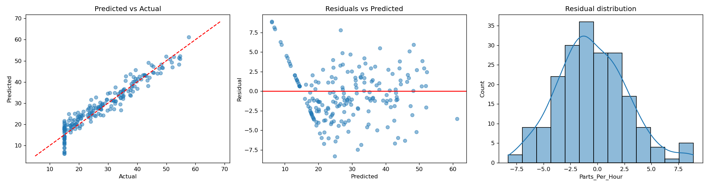
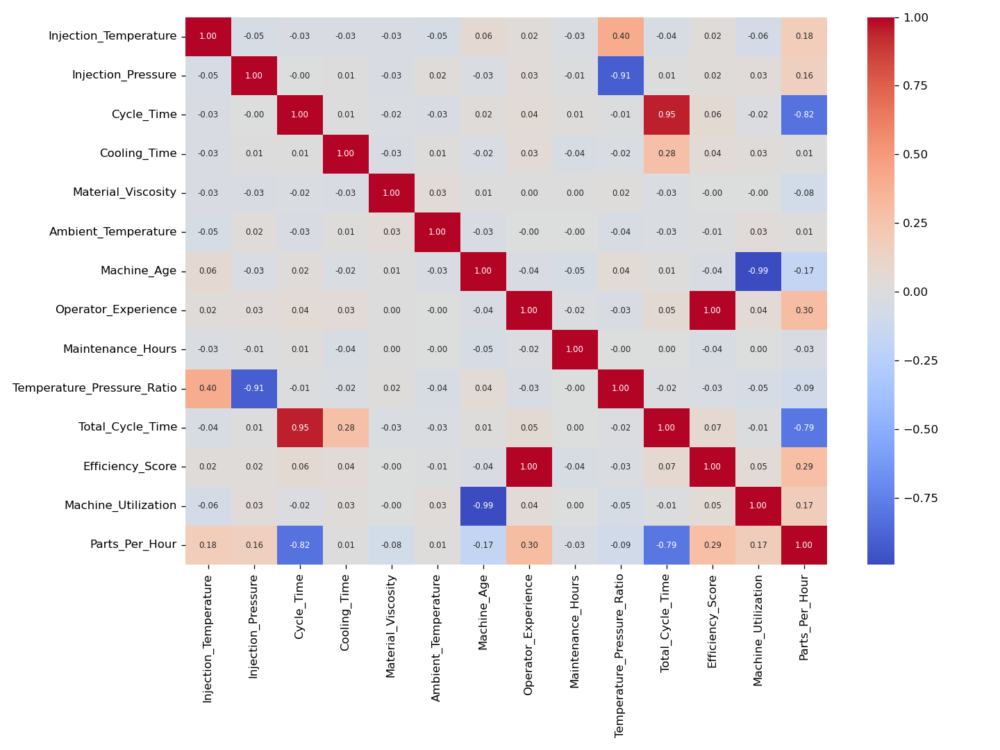

# Injection Molding Output Predictor

Predicts how many parts an injection molding machine produces per hour (`Parts_Per_Hour`) from its operating settings, using **Linear Regression**. The model is served through a **FastAPI** service with a web interface and packaged with **Docker**.

Capstone Project 1: Manufacturing Equipment Output Prediction.

## Overview

A plastic parts factory wants to tune machine settings, plan schedules and spot machines that produce less than expected. This project builds a regression model on 1,000 hourly production records with 17 features:

- **Machine settings:** injection temperature, injection pressure, cycle time, cooling time
- **Material and environment:** material viscosity, ambient temperature, material grade
- **Equipment and operator:** machine age, machine type, operator experience, maintenance hours
- **Context and readings:** shift, day of week, efficiency score, machine utilization, plus derived `Temperature_Pressure_Ratio` and `Total_Cycle_Time`

## Results

Evaluated on a held-out 20% test set (200 rows). All preprocessing is fitted on the training data only.

| Model | R² | RMSE | MAE | 5-fold CV R² |
|---|---|---|---|---|
| **Linear Regression (final)** | **0.919** | **3.25** | **2.61** | 0.921 ± 0.006 |
| Ridge | 0.919 | 3.25 | 2.61 | 0.918 ± 0.009 |
| Lasso | 0.919 | 3.25 | 2.61 | 0.906 ± 0.032 |

Regularisation gives no real gain, so plain Linear Regression is kept as the simplest and most interpretable choice. Average output is about 29.3 parts per hour, so the typical error is about 3.3 parts per hour.

**Key findings**

- Cycle time is the strongest driver (correlation with output: -0.82).
- Operator experience helps (+0.30) and machine age hurts (-0.17).
- Holding other factors equal, the night shift and Type C machines produce about 4 fewer parts per hour, and premium material about 3 more.
- The model is least accurate on Type C machines (RMSE 3.86 vs 2.93 for Type A and B) and on the night shift (3.76 vs 2.90 for the day shift).

**Leakage check.** Efficiency score and machine utilization could be derived from the output. Removing them moves R² only from 0.919 to 0.9165, so the model does not depend on them.

**Underperforming-machine detection.** A machine is labelled underperforming if its output is below 17.7 parts per hour (the 25th percentile of the training data). On the test set: accuracy 0.89, precision 1.00, recall 0.58, F1 0.74. The model raises no false alarms but misses about 4 in 10 underperforming machines.




## Project structure

```
.
├── app/
│   ├── main.py             # FastAPI service (/, /predict, /health, /docs)
│   ├── preprocessing.py    # custom transformers used by the saved model
│   ├── model.joblib        # trained pipeline
│   └── static/index.html   # web interface
├── data/                   # manufacturing_dataset_1000_samples.csv
├── outputs/                # charts and metric tables written by train.py
├── train.py                # EDA, training, evaluation, saves the model
├── requirements.txt        # runtime dependencies (used by Docker)
├── requirements-train.txt  # adds plotting libraries for train.py
├── Dockerfile
└── docker-compose.yml
```

## Getting started

### Run with Docker

```bash
docker compose up --build
```

Open http://localhost:8000 for the web interface or http://localhost:8000/docs for the API docs.

### Run locally

```bash
git clone https://github.com/sathvik-BR/manufacturing-output-prediction.git
cd manufacturing-output-prediction
pip install -r requirements-train.txt
python train.py            # retrains the model and refreshes outputs/
cd app
uvicorn main:app --reload
```

Python 3.11 or newer is recommended. `requirements.txt` pins the scikit-learn version used to save `model.joblib`; keep it, because a saved model can break across scikit-learn versions.

## API

`POST /predict`

```json
{
  "Injection_Temperature": 221,
  "Injection_Pressure": 136,
  "Cycle_Time": 28.7,
  "Cooling_Time": 13.6,
  "Material_Viscosity": 375.5,
  "Ambient_Temperature": 28,
  "Machine_Age": 3.8,
  "Operator_Experience": 11.2,
  "Maintenance_Hours": 64,
  "Shift": "Evening",
  "Machine_Type": "Type_B",
  "Material_Grade": "Economy",
  "Day_of_Week": "Thursday",
  "Efficiency_Score": 0.063,
  "Machine_Utilization": 0.51
}
```

Response:

```json
{
  "predicted_parts_per_hour": 35.82,
  "underperforming": false,
  "underperforming_threshold": 17.7
}
```

`Material_Viscosity`, `Ambient_Temperature` and `Operator_Experience` are optional and imputed when missing. `Temperature_Pressure_Ratio` and `Total_Cycle_Time` are computed automatically. Invalid values, such as an unknown shift, return a `422` validation error.

## Method

1. Split 80/20 first, so the test set stays unseen.
2. Parse `Timestamp` into hour and month.
3. Impute missing values (median for numeric columns, most frequent for categorical).
4. Clip outliers with IQR fences learned on the training data.
5. Scale numeric features and one-hot encode categorical ones.
6. Compare Linear Regression, Ridge and Lasso with 5-fold cross-validation.
7. Check for leakage, evaluate residuals and break errors down by shift, machine type and material grade.

## Limitations

- The dataset is synthetic and small (1,000 rows), so results show a working pipeline rather than real factory performance.
- Cycle time, cooling time and total cycle time overlap heavily, so individual coefficients should not be over-interpreted.
- A linear model cannot capture curved relationships, which limits R² to about 0.92.
- Recall for underperforming machines is 0.58.

## Tech stack

Python, Pandas, NumPy, Scikit-learn, SciPy, Matplotlib, Seaborn, FastAPI, Uvicorn, Docker.

## Team

_Add team member names here._
